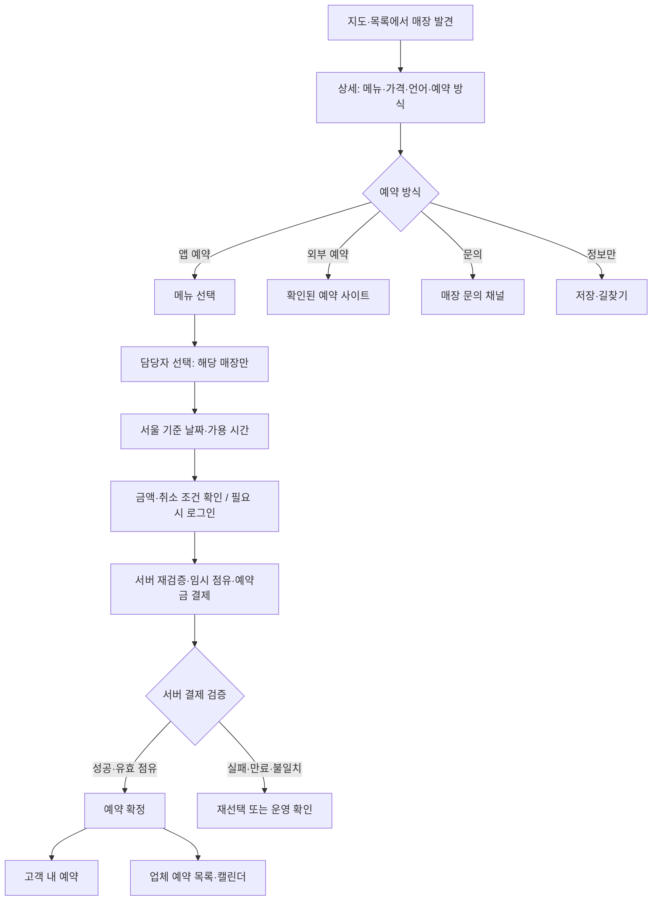

# BeautyNow 비교 검토와 고객 웹앱·예약 연결 작업 범위

검토일: 2026-10-19 (Asia/Seoul)

프로젝트 기준: `codex/service-quality-release-20261018`, `c66c5db` / 업체 관리자 시안 v3.4

상태: **조사 및 범위 제안. 신규 정책·디자인 승인이나 예약 기능 구현 완료를 의미하지 않는다.**

최신 근거: 사용자 제공 `beautynow-booking-audit.html`(10/19 22:37 저장본)의 단계별 URL·스크린샷 14개를 검토했다. [스크린샷 포함 보고서 보관본](references/beautynow-20261019/beautynow-booking-audit.html). 브라우저 조작은 별도 Work 세션에서 진행했고, 이 VS Code 세션에서는 전달받은 파일과 이미지 원본을 확인했다.

## 1. 결론

BeautyNow는 외국인 고객이 한국 뷰티 매장을 찾고 비교하는 구조에서 MYSEOULDROP과 겹친다. 지역·시술별 탐색, 메뉴 가격·소요시간, 언어 정보, 매장별 예약 경로를 참고할 가치가 있다. 저희에게 가장 필요한 다음 작업은 **고객 상세페이지에서 시작해 예약을 확정하고, 고객과 업체가 같은 예약을 조회·처리하는 흐름**이다.

추가 브라우저 점검으로 **갤럭틱 네일즈 이태원점에서 메뉴 → 로그인 → 담당자 → 날짜·시간 → 최종 확인 화면까지 도달한 사실**을 확인했다. 외부 채널만 제공하는 매장과 자체 예약 화면을 제공하는 매장이 함께 있다. 다만 예약 제출·결제·업체 수신·취소 성공은 미검증이다. 자체 예약 표본은 한 매장·한 메뉴·한 담당자이므로 실제 영업 예약의 신뢰성이나 전체 매장 지원 범위까지 보장하지 않는다. [담당자 선택](references/beautynow-20261019/beautynow-booking-audit.html#step8), [최종 요약](references/beautynow-20261019/beautynow-booking-audit.html#step12)

이 표본의 최종 화면은 현장 결제와 매장에서 최종 금액 결정이라는 안내를 제공한다. 저희의 예약금 선결제·즉시 확정 방향에서는 **결제 전 확정된 금액, 서버의 가용성 검사, 고객·업체가 공유하는 예약 기록**이 필요하다. BeautyNow의 선택 화면을 참고하면서 이 세 가지를 별도 완료 기준으로 삼는다.

추천 범위는 다음 세 축이다.

1. **고객 웹앱:** 매장 상세·예약 단계·내 예약을 일관된 구성으로 정돈한다.
2. **예약 연결:** 업체 메뉴·담당자·일정 → 고객 조회 → 예약금 결제 검증 → 예약 저장 → 업체 캘린더를 연결한다.
3. **운영 신뢰성:** 예약/결제/환불 상태를 분리하고, 실패·중복·만료·취소를 고객과 업체 양쪽에 정확히 표시한다.

## 2. 조사 방법과 검증 한계

이번에 확인한 것은 공개 웹 문서의 본문·링크, 검색에 수집된 공식 페이지, 공식 App Store 설명, 프로젝트 소스, 한국어 데스크톱 홈 스크린샷, 그리고 추가 브라우저 점검 보고서의 14개 이미지다. 검색 수집본과 실제 캡처가 다르면 최신 캡처의 관찰 범위를 구분해 기록한다. 보고서의 동작 기록과 정지 이미지로 직접 확인한 사실도 구분한다.

| 확인 대상 | 확인 결과 | 판단할 수 있는 범위 |
| --- | --- | --- |
| BeautyNow 홈 | 루트 주소에서 영문 홈 본문 확보 | 메뉴 구조, 검색 항목, 카드에 노출된 정보 |
| 초기 한국어 매장 상세 2곳 | 본문 및 외부 예약 링크 확보 | 해당 매장의 공개 예약 안내, 메뉴·담당자·위치 정보 |
| 지역×시술 페이지 | 명동·홍대 등 공개 본문 확보 | 비교표, 채널 안내, 지역별 탐색 구조 |
| 언어별 페이지 | 한국어·영어 본문과 일본어·중국어 공개 검색 결과 확인 | 다국어 공개 콘텐츠 존재; 전체 번역 품질은 미검증 |
| 공식 앱 소개 | 게시자가 설명하는 예약·알림·메시지·현장 결제 확인 | 제공한다고 안내하는 기능; 실제 작동 여부와 구분 |
| 검색 결과·예약 방법 필터 | 추가 보고서와 이미지 확인 | 강남·헤어 20곳 → 네이버 예약 조건에서 결과 없음. 이 결과 자체를 오류로 판정하지 않음 |
| 메뉴·담당자·날짜·시간 선택 | 추가 보고서와 이미지 확인 | 한 매장·한 메뉴·한 담당자 선택 후 최종 확인 화면 도달 |
| 로그인 | 비로그인 시 차단 화면, 사용자 로그인 후 재개 기록 | 담당자 선택 전 인증 필요. 자동 선택 복원·로그인 전후 모든 경로는 미검증 |
| 최종 확인·정책·제출 버튼 | 이미지 확인 | 제출 전 화면 존재. 실제 제출 성공과 구분 |
| 약 10분 임시 확보 | 보고서의 동작 기록 | 서버의 독점 점유·중복 예약 차단·만료 해제는 별도 검증 필요 |
| 예약 생성·결제·취소·환불·알림·내 예약 | 미검증 | 거래 완료·업체 수신·후속 처리 성공으로 표현하지 않음 |
| 데스크톱 홈의 시각 구성 | 사용자 제공 21:59:56 스크린샷 확인 | 색·정보 배치·화면에 보이는 탐색 항목만 검토. 7.4절 |
| 좁은 너비의 예약 화면 구성 | 추가 이미지 확인 | 원본 이미지 너비 590~592px. 기기·CSS 뷰포트 정보는 없으므로 실기기 모바일 검증과 구분 |
| 실기기 터치·접근성·성능 | 미검증 | 정지 이미지로 조작 품질이나 성능을 판정하지 않음 |

초기에는 이 VS Code 환경의 브라우저 연결 실패로 공개 문서만 확인했다. 이후 사용자가 별도 Work 세션에서 점검을 진행하고 직접 로그인해 준 결과를 제공했다. 계정 생성·예약 제출·결제·매장 문의 전송은 하지 않았다는 보고가 있다. 다만 최종 확인 화면 진입 시 임시 시간 확보가 있었다고 기록되어 있으므로, 그 과정 전체가 아무 상태도 바꾸지 않는 조회였다고 표현하지 않는다.

## 3. BeautyNow의 서비스 구조

### 3.1 고객 탐색

확보한 영문 홈 본문에는 Home / Explore / Bookings / Profile 탐색이 나온다. 지역·시술·날짜를 검색 축으로 제시하며, 카테고리·동네·추천·인기·신규 매장 묶음과 가격·일부 평점 및 리뷰 수가 있다. 날짜나 당일 가능 항목이 화면에 있는 사실과 실제 가용 시간 검색이 작동하는지는 구분해야 한다. [BeautyNow 홈](https://beautynow.kr/en)

추가 제공된 한국어 데스크톱 홈 스크린샷에서는 상단에 탐색 / 예약 / 저장 / 고객센터 / 프로필이 보이고, 검색·입점 신청·언어·로그인이 함께 배치되어 있다. 따라서 수집된 영문 본문의 탐색 항목을 모든 언어·화면 크기에 공통인 전체 내비게이션으로 단정하지 않는다.

지역×시술 페이지는 매장 목록과 가격·예약 채널 비교를 제공한다. 홍대 헤어 페이지에는 지도·필터로 이동하는 링크와 다른 지역·시술로 이어지는 탐색도 있다. 이는 여행자가 지역과 목적을 정해 들어올 때 참고할 만하다. [홍대 헤어](https://beautynow.kr/en/seoul/hongdae/hair), [명동 헤어](https://beautynow.kr/ko/seoul/myeongdong/hair)

### 3.2 매장 상세와 예약 경로

| 표본 | 공개 페이지에서 확인한 것 | 예약 검증 결과 |
| --- | --- | --- |
| 헤리크 명동 | 메뉴별 가격·시간, 담당자 소개, 영업시간, 지도·교통, 외부 채널 | BeautyNow 예약 미지원 안내. 네이버 예약·인스타그램·매장 웹사이트·전화로 연결 안내 |
| 플로르 네일 이태원점 | 시작 가격·상담 후 결정 가격, 시술 시간, 영업시간, 지도·교통 | BeautyNow 예약 미지원 안내. 인스타그램·전화 안내. 일부 메뉴는 문의 후 확정 |
| 온야드 강남점 — 추가 캡처 | 외부 예약 안내·인스타그램 DM·전화 버튼 | 외부 목적지만 확인. DM·전화 실행이나 외부 예약 완료는 미검증 |
| 갤럭틱 네일즈 이태원점 — 추가 캡처 | 자체 예약 버튼, 메뉴·담당자·날짜·시간·최종 확인 | 네일아트 → 은하 → 10/22 10:00 → 최종 화면. 제출 전 중단 |

출처: [헤리크 상세](https://beautynow.kr/ko/salons/b83e25c0-e6cc-4455-99f7-25c7f6bc2ca5), [플로르 상세](https://beautynow.kr/ko/salons/ca8b55e1-9e44-44b1-bf30-06981132c279). 외부 예약 링크의 존재까지 확인했으며, 외부 서비스에서의 예약 완료는 확인하지 않았다.

추가 출처: [온야드 캡처](references/beautynow-20261019/beautynow-booking-audit.html#step4), [갤럭틱 상세 캡처](references/beautynow-20261019/beautynow-booking-audit.html#step5). 단계별 원래 URL은 보관본에 있으며 최종 URL의 임시 확보 토큰은 비공개 처리되어 있다.

### 3.3 공식 소개가 설명하는 예약·업체 운영

앱 게시자는 서비스·스타일리스트·날짜/시간 선택, 확정 알림, 예약 변경/취소 요청, 고객 메시지, 방문 리뷰를 설명한다. 업체용으로는 예약·스케줄·메시지·리뷰 관리를 안내하며, 결제는 방문 시 현장 결제로 설명한다. 추가 점검은 선택 화면과 현장 결제 안내를 뒷받침하지만, 알림·메시지·업체 콘솔·거래 완료는 여전히 **게시자의 기능 설명** 수준이다. [공식 App Store 소개](https://apps.apple.com/kr/app/뷰티나우-k-뷰티샵-예약/id6807783007)

홈·상세 하단에는 약관·개인정보·고객지원 링크와 사업자 안내가 있다. 링크 대상의 정책 본문은 확보하지 못했으므로 취소 규정, 개인정보 처리 범위, 운영 책임의 적정성은 판단하지 않았다.

## 4. 저희 서비스와 비교한 실제 차이

현재 고객 앱 코드는 발견·저장 중심이며, 업체 시안 v3.4는 예약 운영 화면을 제시한다. 두 화면 사이의 예약 저장과 결제 연결이 아직 필요하다. 이 검토는 로컬 기준 커밋에 대한 분석이며, 현재 운영 배포의 코드가 동일한지 새로 확인한 결과는 아니다.

| 영역 | 현재 프로젝트에서 확인한 상태 | 다음 작업 |
| --- | --- | --- |
| 진입·탐색 | `/` → `/map`. 하단 Map / Stories / Ranking / Saved / My | 지도 유지 기본안에서 예약 탐색을 강화. 탭 재편은 별도 디자인 결정 |
| 예약 가능 표시 | `Bookable`은 `bookingChannels`가 하나 이상인지 검사 | 자체 예약 가능·외부 예약·문의·정보만 제공을 구분 |
| 상세 메뉴 | 확인되지 않은 가격 안내와 원본 목록 링크. 앱 내 예약 비활성화 | 승인된 업체 메뉴를 공개 조회해 상세에 연결 |
| 외부 예약 | `place.url`은 실제 원본 링크. 채널 목록은 채널 종류만 보유 | 공식 채널별 URL·검증 시점·지원 내용을 별도 관리 |
| 기존 예약 데모 | 고정 매장·메뉴·시간, 담당자 선택 없음. 예약 저장 없이 화면 단계 변경 | 실제 데이터로 새 예약 흐름 구성. 데모의 완료·정책 문구 재사용 금지 |
| 내 예약 | 경로 상수는 있으나 고객 예약 페이지 구현이 없음. My에서 진입 숨김 | 예약 목록·상세·취소·환불 상태와 재진입 경로 구현 |
| 메뉴 다국어 | 한국어·영어 이름/설명, 금액·예약금·시간 검증이 이미 있음 | 기존 컬럼·공개 조건을 재사용. 중복 스키마 추가 불필요 |
| 담당자 다국어 | 현재 모델은 영문 이름·소개 확장 필요 | 메뉴와 달리 담당자는 저장 계약 및 화면을 함께 확장 |
| 시간 계산 | 메뉴·담당자·일정·기존 점유를 반영하는 계산 모듈 존재 | 공개 조회 및 원자적인 점유·예약 저장과 결합 |
| 업체 관리자 | 메뉴·담당자·일정 저장 구현, 예약 캘린더·정산 등은 시안 | 같은 서버 기록으로 고객·업체 화면 연결 |
| 디자인 기준 | 실제 CSS는 오렌지, 일부 디자인 문서는 과거 민트 값 | 현재 브랜드 기준으로 문서와 공통 토큰 정합성부터 정리 |

근거 파일:

- 탐색: [시작 경로](../../app/page.tsx), [하단 내비게이션](../../components/ui/bottom-nav.tsx), [My](../../app/menu/page.tsx).
- 예약 가능 판단: [장소 필터](../../lib/places.ts), [필터 화면](../../components/map/filter-sheet.tsx), [장소 데이터 계약](../../lib/data.ts).
- 고객 상세: [place-detail-body.tsx](../../components/place/place-detail-body.tsx).
- 사용되지 않는 데모: [booking-sheet.tsx](../../components/booking/booking-sheet.tsx), [channel-sheet.tsx](../../components/booking/channel-sheet.tsx), [cancel-booking-button.tsx](../../components/booking/cancel-booking-button.tsx). 현재 공개 흐름에서 사용되는 결함으로 집계하지 않는다. 특히 ChannelSheet는 외부 링크를 여는 구현 없이 토스트만 표시하므로 그대로 연결하면 안 된다.
- 재사용할 기반: [메뉴 계약](../../lib/partner/catalog.ts), [서버 매핑](../../lib/partner/server.ts), [가용 시간 계산](../../lib/partner/reservation-slots.ts), [예약 규칙·날짜 예외 저장](../../lib/partner/reservation-store.ts).
- 디자인: [실제 CSS](../../app/globals.css), [디자인 문서](../../docs/design-system.md), [디자인 컨텍스트](../../.impeccable.md).

## 5. 가져올 만한 구성과 적용 우선순위

아래는 BeautyNow 관찰을 바탕으로 한 **저희 서비스에 대한 제안**이다. 상대 서비스의 내부 구현 방식을 추정한 내용이 아니다.

| 우선순위 | 적용할 구성 | 저희에게 필요한 형태 |
| --- | --- | --- |
| P0 | 예약 경로의 명확한 구분 | 버튼에 앱 예약·외부 예약·문의 목적을 표시. 외부 이동을 자체 예약 완료로 기록하지 않음 |
| P0 | 가격·시간·조건이 모인 메뉴 | 총액 / 지금 결제할 예약금 / 현장 잔액 / 소요시간 / 포함·추가 조건을 한 흐름에서 확인 |
| P0 | 예약 뒤 관리 경로 | 확정 번호, 방문 시각·위치, 상태, 취소·환불, 문의 경로를 예약 상세에 제공 |
| P1 | 지역·시술·날짜로 찾기 | 현재 지도·목록에 지역·시술 선택 강화. 날짜 필터는 실제 재고 조회 연결 후 공개 |
| P1 | 매장·담당자 언어 정보 | 앱 표시 언어와 직원 응대 언어를 별도 표시. 번역된 메뉴만으로 영어 응대를 보장하지 않음 |
| P1 | 정보의 밀도가 일정한 카드 | 대표 사진, 매장명, 위치, 검증된 가격, 예약 방식. 비교에 필요한 정보부터 배치 |
| P2 | 지역×시술 탐색 페이지 | 신뢰할 수 있는 카탈로그가 쌓인 뒤 검색 유입·공유용 페이지로 확장 |
| P2 | 방문 리뷰·메시지 확장 | 예약 기록과 연결된 방문 리뷰, 번역·실시간 채팅은 핵심 예약 이후 검토 |

적용 시 지킬 조건:

- 기존 승인 방향은 **자체 예약 + 예약금 + 결제 검증 후 즉시 확정**이다. 경쟁 앱의 현장 결제 안내만으로 변경하지 않는다.
- 조회수·인기 순위·외부 리뷰·실제 예약 방문 리뷰는 각각 다른 근거다. 서로 대체하지 않는다.
- 금액 미확인은 `가격 문의` 등으로 표시한다. 미설정 금액을 0원으로 바꾸지 않는다.
- 범위 가격·상담 가격은 탐색 정보로는 유용하다. 초기 자체 예약 상품은 결제 전에 최종 금액이 확정되어야 한다.
- 영업 중이라는 이유만으로 `오늘 예약 가능`을 표시하지 않는다. 메뉴 시간·담당자·수용량을 함께 검사한다.
- 경쟁사 사진·문구·리뷰를 우리 매장 데이터로 복제하는 범위는 포함하지 않는다.

## 6. 제안하는 고객 예약 구조

### 6.1 매장별 네 가지 예약 방식

| 방식 | 노출 조건 | 대표 행동 |
| --- | --- | --- |
| 앱에서 예약 | 장소↔업체 연결 승인, 공개 가능한 메뉴·일정·수용량·결제 연결 준비 | 메뉴 선택 → 담당자/시간 → 예약금 결제 |
| 외부에서 예약 | 검증된 공식 예약 URL 보유 | `네이버에서 예약` 등 목적지를 표시하고 이동 |
| 문의 후 예약 | 문의 채널은 있으나 앱 재고·확정 가격 없음 | `매장에 예약 문의`와 실제 문의 채널 제공 |
| 정보만 제공 | 검증된 예약·문의 채널 없음 | 저장·길찾기·정보 확인 경로 제공 |

이 구분은 서버가 제공하는 검증된 정보에 근거한다. 현재의 채널 종류 배열만으로 앱 예약을 활성화하지 않는다. 한 매장에 여러 채널이 있어도 내부 예약과 외부 문의의 결과를 섞지 않는다.

### 6.2 자체 예약의 고객 흐름

흐름의 필수 조건:

- 담당자 선택형은 메뉴를 제공할 수 있는 담당자만 보여 준다. 매장 예약형은 이 단계를 생략한다.
- 탐색은 로그인 없이 가능하게 두고, 로그인 후 선택 내용으로 복귀하는 흐름을 설계한다. 복귀 시 가용성과 금액은 다시 확인한다.
- 시간 기준을 `Asia/Seoul`로 표시한다. 여행자의 기기 시간대가 달라도 예약 시각이 바뀌지 않아야 한다.
- 조회한 빈 시간은 확정이 아니다. 결제 시작 시 서버가 다시 검사하고 점유를 확보한다.
- 결제 복귀 화면만으로 예약 성공을 표시하지 않는다. 서버에서 확인된 예약 번호를 받아 표시한다.
- 고객과 업체는 같은 예약 번호·가격 기록·상태를 조회한다. 메뉴를 바꿔도 기존 예약 조건은 유지한다.
- 예약 취소와 환불 완료는 별도다. 취소됨 + 환불 처리 중/실패 상태를 모두 표현한다.
- 화면 복귀·변경 후 재조회하고, 조회 실패를 빈 목록이나 예약 가능으로 표현하지 않는다.

이 조건은 [승인된 예약 운영 설계](../../docs/superpowers/specs/2026-10-18-partner-reservation-operations-design.md)의 연결·점유·시간 기준을 따른다. 로그인 시점과 화면 배치는 이번 제안이며 상세 설계에서 확인한다.

## 7. 고객 웹앱 디자인 개편 범위

### 7.1 기본 방향

현행 지도 중심 진입을 기본안으로 두고 **매장 상세 → 예약 → 내 예약**을 먼저 정돈한다. 지도 유지 자체는 기존 결정이며, 이번에 질문한 지도 중심 유지/탐색 홈 전환/두 시안 비교에는 아직 새 답이 없다. 따라서 새로운 홈 구조나 탭 교체가 승인되었다고 간주하지 않는다.

화면의 첫 인상은 사진·매장명·예약 판단 정보로 만들고, 긴 설명·영업 정보는 아래로 정리한다. 같은 역할의 배지와 카드를 줄이고 주요 행동 버튼을 하나로 모은다. 가격과 예약 상태는 장식보다 읽기 쉬운 글자·간격·대비를 우선한다.

현재 적용된 오렌지 브랜드를 기준으로 버튼·상태·입력·카드 토큰을 정리한다. 민트로 적힌 과거 디자인 문서는 함께 갱신해야 한다. 색상 교체는 이번 검토의 확정 사항이 아니다. 실제 색 대비, 터치 크기, 키보드 초점은 구현 화면에서 측정한다.

### 7.2 화면 단위의 범위

| 화면 | 개선 내용 | 필요한 데이터 |
| --- | --- | --- |
| 지도·검색 목록 | 예약 방식 필터, 지역·시술, 일관된 카드, 목록/지도 전환 시 선택 유지 | 장소 정보, 검증된 예약 방식; 날짜 조건은 가용성 연결 후 |
| 매장 상세 | 사진·가격·언어·위치 요약, 메뉴 중심 구성, 하단 주요 행동 | 승인된 공개 매장·메뉴·채널 |
| 메뉴 선택 | 가격·시간·구성·추가 조건, 선택 요약 | 업체 공개 메뉴 |
| 담당자 선택 | 영문 이름·소개·제공 메뉴, 직접 선택 | 해당 메뉴의 공개 담당자 |
| 날짜·시간 | 가능/마감/휴무/조회 실패 구분, 서울 시간 안내 | 서버 가용 시간 |
| 예약 확인·결제 | 총액·예약금·잔액·취소 기준, 선택 변경 | 유효한 견적·점유·정책 버전 |
| 결제 결과 | 검증 중·확정·실패·점유 만료·운영 확인 | 서버 예약·결제 결과 |
| 내 예약 목록·상세 | 예정/지난 예약, 상태, 길찾기·취소·문의 | 본인 예약과 처리 이력 |
| 취소·환불 | 실행 전 환불 예상액, 취소 후 처리 상태·지원 | 서버 정책 계산·환불 기록 |
| Saved·My 진입 | 저장한 매장에서 이어 예약, 내 예약 재진입 | 저장 목록과 본인 예약 |

전체 화면 수보다 위 흐름의 연결을 완료 기준으로 삼는다. 예약 진입은 우선 My와 확정 후 상세에 확보한다. 하단에 예약 탭을 넣는 안은 기존 Stories·Ranking의 이동 위치까지 함께 비교한 후 결정한다.

### 7.3 정보 구성의 접근 비교

| 안 | 기대 효과 | 추가 범위 |
| --- | --- | --- |
| A. 지도 유지 + 예약 탐색 강화 — 기본 추천 | 기존 길찾기·발견 흐름과 예약 연결을 함께 유지 | 상세·예약·내 예약, 필터와 카드 정돈 |
| B. 지역·시술·날짜 탐색 홈 중심 | 예약 목적이 분명한 사용자가 조건을 먼저 입력 | 홈 신설, 지도 진입 재배치, 하단 탭과 기존 콘텐츠 위치 재검토 |
| C. A/B 핵심 화면 비교 후 선택 | 지도 이용과 예약 이용의 우선순위를 화면으로 판단 | 저충실도 주요 화면 두 안. 실제 사용자 과제 확인 후 하나로 수렴 |

BeautyNow를 시각적으로 더 우수하다고 판정한 것은 아니다. 이번 제안은 공개 정보 구조, 추가 캡처에서 확인한 선택 흐름과 불일치, 저희 코드에서 드러난 예약 연결의 공백에 근거한다.

### 7.4 사용자 제공 데스크톱 홈에서 확인한 디자인

근거: 사용자가 제공한 `2026-10-19 오후 9.59.56` 스크린샷. 한국어 홈과 Chrome의 ChatGPT Work 패널이 함께 보인다. 에이전트가 브라우저를 직접 조작해 얻은 화면은 아니다.

| 화면에서 관찰한 요소 | 저희 서비스에 적용할 제안 |
| --- | --- |
| 흰 배경, 따뜻한 회색 소개 영역, 검정 주요 버튼, 분홍 포인트 | 중립색으로 정보 위계를 만들고 기존 오렌지는 선택·주요 행동에 제한적으로 사용 |
| 지역·시술·날짜가 한 검색 바에 모임 | 예약 목적의 조건을 한곳에서 조정하고 지도·목록에도 같은 조건 유지 |
| 검색 아래 지역·시술·가격·당일 가능 바로가기 | 실제 데이터로 실행할 수 있는 바로가기만 제공. 당일 예약은 재고 조회 연결 후 노출 |
| 시술 카테고리를 일정한 아이콘·라벨 형식으로 배치 | 카테고리별 표현을 통일하되 선택 상태와 결과로 이어지는 행동이 분명하도록 설계 |
| 큰 소개 영역 아래에 카테고리와 추천 매장이 이어짐 | 모바일 예약 목적에서는 소개 영역의 높이와 매장 결과가 보이는 시점을 별도 비교 |
| 소개 영역과 상단에 검색 진입이 각각 있음 | 저희 앱에서는 각 검색의 목적·동작을 통일해 중복 입력이나 다른 결과를 피함 |

이 화면은 탐색 조건과 시술 분류를 빠르게 파악하게 한다. 다만 소개 영역이 큰 만큼 해당 크기의 창에서 실제 매장 정보는 아래쪽부터 보인다. 이를 모바일에 그대로 옮기는 것이 적합한지는 검증이 필요하다. 단일 스크린샷으로 추천 매장 수, 카드 아래 내용, 로딩 상태, 클릭 동작을 추정하지 않는다.

### 7.5 추가 예약 화면에서 확인한 문제와 적용 기준

아래의 관찰은 한 매장의 점검 결과다. 화면 간 불일치는 확인할 수 있지만 내부 원인과 실제 영업 설정은 알 수 없다.

| 항목 | 확인 근거·한계 | 저희 서비스의 적용 기준 |
| --- | --- | --- |
| 휴무 안내와 가능한 날짜 | 상세는 월~수 휴무, 초기 예약 화면은 10/20 화요일의 시간 목록 노출. 특별 영업 예외인지 오류인지는 미확인 | 매장 일정·날짜 예외·담당자 일정·점유를 함께 검사. 예외 영업이면 고객에게 해당 날짜의 안내도 일치시킴 |
| 필수 추가금·추가 시간 | 목록은 10,000~30,000원·60분. 필수 옵션이 붙은 화면은 20,000원부터·110분 | 필수 비용·시간은 처음 메뉴에서 포함해 표시. 초기에는 포함 조건이 명확한 고정 금액 메뉴로 운영 |
| 담당자 재확인 | 시간 선택 화면에는 은하가 보이나, 전달된 최종 요약 영역에는 담당자명이 보이지 않음 | 최종 확인·완료·내 예약에 같은 담당자명을 표시하고 선택 변경 경로 제공 |
| 표시 시간과 예약 구간 | 보고서는 선택 화면 110분과 최종 URL의 10:00~12:00을 비교. 원 URL은 토큰 비공개로 재검증 불가 | 고객 시술 시간과 서버 점유 시간(정리 시간 포함)을 분리. 차이가 고객 방문에 영향을 주면 안내. 경쟁사 차이의 원인을 단정하지 않음 |
| 임시 시간 확보 | 보고서에 최종 확인 진입 시 약 10분 확보 및 만료 시각 기록. 동시 요청·만료 후 상태는 미검증 | 서버 만료 시각 기반 안내, 만료 후 재선택, 중복 점유 방지. 확보 시간을 경쟁사와 같게 정할 필요는 없음 |
| 확정 단계의 문구 | 시간 팝업의 버튼은 ‘이 시간으로 예약’, 최종 화면은 ‘예약하기’ | 중간 단계는 ‘예약 정보 확인’, 실제 결제 단계는 결제 금액·결과를 설명하는 문구로 구분 |
| 가격·결제 확실성 | 최종 요약은 20,000원부터, 최종 금액은 매장 결정, 현금·국내 카드 안내 | 선결제 모델에서는 총액·예약금·잔액과 사용 가능한 결제 수단을 결제 전에 확정 |
| 데이터 공개 품질 | 0원 메뉴, ‘30분 테스트’라는 메뉴에 60분 표기, 숫자로 된 담당자명 관찰 | 필수 공개 정보 검증과 실제 판매 승인. 이런 표기만으로 상대의 DB가 테스트 환경이라고 단정하지 않음 |
| 자체 예약 찾기 | 검색의 예약 방법 필터에는 외부 채널 종류만 보임 | 자체 예약과 외부 예약을 구분하는 필터·카드 라벨 제공 |

근거: [상세·영업시간](references/beautynow-20261019/beautynow-booking-audit.html#step5), [메뉴](references/beautynow-20261019/beautynow-booking-audit.html#step6), [초기 날짜·시간](references/beautynow-20261019/beautynow-booking-audit.html#step9), [시간 팝업](references/beautynow-20261019/beautynow-booking-audit.html#step11), [최종 요약](references/beautynow-20261019/beautynow-booking-audit.html#step12).

가져올 디자인은 **일정한 메뉴 행, 담당자·시간의 명확한 선택 상태, 단계마다 하나의 주요 행동, 간결한 최종 요약**이다. 지도와 목록의 결합도 기존 지도 중심 방향과 맞는다. 저희 예약 화면에는 진행 단계와 선택 내용을 유지해 앞 단계 수정 시 맥락을 잃지 않도록 한다.

전체 페이지 캡처의 빈 영역·누락된 사진·중간에 찍힌 고정 하단 바는 캡처 방식이나 지연 로딩의 영향일 수 있다. 실제 표시 오류로 확정하지 않는다. 또한 상대의 ‘아무나 괜찮아요’는 기존 승인 범위인 담당자 직접 선택에 포함하지 않는다.

## 8. 실행 순서와 완료 기준

| 단계 | 구체적인 작업 | 완료 기준·선행 조건 |
| --- | --- | --- |
| 1. 정책·화면·데이터 기준 맞추기 | 상세→예약→내 예약 핵심 시안, 상태표, 필드별 공개 책임, 기존 데모 문구 정리 계획 | 자체/외부/문의 흐름이 구분되고 결정 전 정책이 표시됨. 신규 화면 방향 검토 |
| 2. 업체 데이터를 고객에게 공개 | 장소↔업체 연결, 공개 메뉴·담당자 조회, 영문 정보, 검증된 외부 채널, 고객 상세 연결 | 업체 메뉴 변경이 같은 매장의 고객 조회에 반영. 비공개·다른 업체 정보 제외 |
| 3. 예약 기록과 임시 점유 | 예약·결제·환불 기록 구분, 정책/금액 기록, 점유 만료, 경쟁 요청 검사, 고객·업체 조회 권한 | 동일 자리를 동시 요청해도 수용량 이하만 점유. 고객·업체가 같은 예약을 조회 |
| 4. 고객·업체 화면 연결 | 실제 메뉴·담당자·시간 선택, 내 예약, 관리자 캘린더·목록·상태 변경 | 고정 데모 제거. 실패·재시도·로그인 복귀·일정 충돌 처리 확인 |
| 5. 실제 결제·환불·알림 연결 | 선정된 결제사의 테스트 환경에서 검증, 중복 요청/통지 처리, 취소·환불, 알림 재시도·운영 예외 조회 | 수납 주체·정책·결제사 결정 필요. 검증된 결제만 확정, 늦은 결제·실패 환불도 추적 |
| 6. 파일럿·정산 확인 | 파일럿 업체의 전체 시나리오, 실기기 확인, 수납·환불·정산 대조 | 고객 예약부터 업체 처리까지 연결 확인. 정산은 우선 읽기 전용 명세·운영 수동 확인 |

2단계의 공개 정보 연결은 실제 결제 도입과 독립적으로 시작할 수 있다. 3~5단계는 처음부터 하나의 예약 흐름으로 설계하고, 결제 연결 전에는 운영 고객에게 결제·예약 확정을 공개하지 않는다. 테스트용 데이터와 운영 예약은 구분한다.

새 결제사·알림 서비스 제품 선정이나 계정 개설은 이번 범위에서 수행하지 않았다. 먼저 돈의 흐름·해외 고객 결제 요구·운영 책임을 정리한 후, 프로젝트의 기존 환경과 사용할 수 있는 실제 연동을 확인해 구현 계획을 확정한다.

기존 [출시 준비 검토](../operations/partner-service-launch-readiness-2026-10-19.md)의 파일럿 3곳을 활용한다면, 동일 규칙으로 운영 가능한 미용실·네일·헤드스파를 우선한다. 다인 예약, 담당자 자동 배정, 상담 후 금액이 달라지는 의료 예약, 다회차 이용권은 초기 범위에 추가하지 않는다.

### 8.1 다음 작업으로 제안하는 구체적인 화면 묶음

추가 점검 결과에 따라 고객용 예약 개편을 아래 8개 화면 묶음으로 구체화한다. 이는 작업 범위 제안이며, 디자인 승인·결제 정책 확정을 대신하지 않는다. 기존 관리자 시안 v3.4는 데이터 연결 대상으로 유지한다.

| 순서 | 화면 묶음 | 시안에서 반드시 확인할 것 |
| --- | --- | --- |
| C1 | 지도·검색 결과 | 자체/외부/문의 구분, 조건 초기화, 결과 없음과 조회 실패의 차이 |
| C2 | 매장 상세·메뉴 | 공개 승인된 메뉴, 필수 비용 포함 가격·시간, 담당자 선택 여부, 외부 예약의 실제 목적지 |
| C3 | 담당자 선택 | 메뉴 제공 가능 담당자만 표시, 영문 이름·소개, 직접 선택, 뒤로 가기 시 메뉴 유지 |
| C4 | 날짜·시간 | 서울 시간, 휴무·예외·정원 반영, 선택 요약, 시간 없음·조회 실패·선점됨 상태 |
| C5 | 예약 정보·결제 확인 | 매장·메뉴·담당자·시각·총액·예약금·잔액·취소 기준, 로그인 복귀, 확보 시간 만료 |
| C6 | 결제 및 예약 결과 | 서버 확인 중·확정·실패·운영 확인을 구분. 확정된 예약 번호로 다음 단계 이동 |
| C7 | 내 예약 목록·상세 | 업체와 같은 예약 번호·상태, 담당자·방문 정보, 길찾기·취소·문의 경로 |
| C8 | 취소·환불 | 실행 전 환불 예상액, 취소 후 처리 중·완료·실패, 문의·재처리 안내 |

첫 디자인 검토의 중심은 C2~C5로 잡는다. 동시에 C6~C8의 상태를 정의해 성공 화면만 완성되는 것을 피한다. 로그인 전 탐색 가능 범위와 로그인 후 선택 복원을 설계하되, 점유·결제 요청은 인증과 서버 검증을 거친다.

첫 실제 연결 단위는 **검증된 한 업체의 공개 메뉴 → 담당자 → 가용 시간 → 예약금 검증 → 같은 예약 번호의 고객 상세·업체 캘린더**다. 메뉴 영문 컬럼·공개 조건·가용 시간 계산을 재사용하고, 장소↔업체 연결·예약 저장·결제 검증을 추가한다. 결제사와 정책이 정해지기 전에도 공개 메뉴 연결은 진행할 수 있다.

이번 개편에서 별도 옵션 엔진·담당자 자동 배정·새 지도 엔진·실시간 채팅을 선행 과제로 추가하지 않는다. 초기 상품은 필수 구성과 시간이 포함된 메뉴로 만들고, 차이가 있으면 명확한 별도 메뉴로 등록하는 기존 승인 방향을 유지한다.

## 9. 먼저 정리할 정책·문서 불일치

| 항목 | 현재 근거와 차이 | 정리할 내용 |
| --- | --- | --- |
| 예약금·환불·확정 방식 | 승인 방향은 예약금·즉시 확정. 오래된 데모는 25%·24시간 관련 문구, v3.4는 정액 1만 원 등 가정 | 데모와 시안 숫자를 정책으로 가져오지 않음. 서버 정책과 고객 고지의 기준을 하나로 지정 |
| 수수료 | v3.4의 10% 예시는 예약금 기준 계산 | 예약금 기준인지 총 시술금액 기준인지 명시적으로 결정 |
| 일정 변경 충돌 | 승인 설계는 확정 예약·유효 점유를 침해하는 변경 거절. 시안에는 예약이 있는 휴무 설정 경고 흐름 존재 | 구현 전에 정책과 경고/거절 동작을 일치시킴 |
| 메뉴 영문 컬럼 | 핸드오프의 추가 안내와 달리 메뉴 영문 이름·설명 저장은 이미 구현 | 메뉴는 재사용, 담당자는 필요한 확장만 수행 |
| 매장 공개 정보 | 기존 승인은 운영팀 관리. v3.3은 즉시 반영/검수 제안 | 업체별 수정 권한, 승인 대상, 고객 반영 시점 결정 |
| 디자인 토큰 | 적용 CSS 오렌지, 일부 문서 민트 | 기준을 통일하고 후속 화면에서 혼용 방지 |

실제 결제 개발을 구체화하기 위해 필요한 결정은 다음과 같다. 이번 조사로 확정하지 않았다.

1. 예약금을 누가 받고 누가 환불·정산을 책임지는가.
2. 예약금 금액·산식, 수수료 산정 기준·율, 지급 주기.
3. 서울 시간 기준 취소 마감과 환불률, 업체 취소·노쇼·결제 수수료 부담.
4. 파일럿 업체, 매장 연결·공개 승인 담당자, 결제·환불 예외 대응 담당자.
5. 업체 수정 가능 항목과 즉시 반영/검수 구분. 고객 연락처 보관·접근 범위.

## 10. 실제 연결 시 검증할 시나리오

| 시나리오 | 통과 조건 |
| --- | --- |
| 일반 예약 | 고객 확정 번호가 업체 캘린더·목록에 동일하게 표시 |
| 다른 고객·업체 접근 | 본인 예약과 소속 업체 권한 밖의 데이터 접근 거절 |
| 메뉴·담당자 변경 | 신규 선택에만 반영하며 기존 예약의 가격·담당자 기록 유지 |
| 동일 시간 동시 요청 | 담당자·매장 수용량을 초과하지 않음 |
| 로그인 복귀·새로고침·뒤로가기 | 선택 복원 후 재검증. 중복 예약·결제 방지 |
| 휴무·차단·일정 수정 | 기존 예약·유효 점유와 충돌하는 변경은 확정된 정책대로 처리 |
| 시간·가격 오류 | 서울 날짜 경계 일치. 미확인 금액은 무료로 표시하지 않음 |
| 목록→최종 요약 일치 | 필수 구성을 포함한 가격·시간이 유지되고 담당자·예약일시가 최종 확인에 포함 |
| 시술 시간과 점유 시간 | 고객 시술 시간에 정리 시간을 더한 구간이 실제 점유와 일치. 표시용 반올림으로 중복 예약이 생기지 않음 |
| 임시 확보 만료 | 화면 재진입·새로고침으로 임의 연장되지 않으며, 만료 후 결제·재선택을 서버가 정책대로 처리 |
| 결제 통지 지연·중복 | 화면 이동과 무관하게 서버 검증. 중복 처리 없이 결과 추적 |
| 점유 만료 뒤 결제 성공 | 새 예약을 무조건 확정하지 않고 정해진 예외 처리·안내 수행 |
| 고객/업체 취소·환불 실패 | 예약 상태와 환불 진행·실패·재처리 상태가 양쪽 화면에 일치 |
| 외부 채널 이동 | 실제 공식 목적지로 이동. 외부 이동을 자체 예약 확정으로 집계하지 않음 |
| 모바일·접근성 | iOS Safari·Android에서 스크롤/선택/키보드/고정 버튼 확인, 확대·초점·상태 안내 점검 |
| 관리자 터치 | 실제 기기에서 예약 블록 위 쓸기는 스크롤, 길게 누른 뒤 이동만 시간 변경 |
| 장애·알림 누락 | 예약 기록은 유지, 조회 실패 명시, 알림 재시도·지원 담당자의 확인 경로 확보 |
| 정산 대조 | 실제 수납·환불·귀속·수수료가 명세와 일치. 예약 상태만으로 입금 추정 금지 |

v3.4의 206개 검증은 기존 기록이다. 이번 조사에서 다시 실행하거나 실제 예약 연동 검증으로 대체하지 않았다.

## 11. BeautyNow 검증 이력과 남은 항목

추가 보고서로 자체 예약 표본의 선택 과정과 최종 화면을 확보했다. 다음 항목은 여전히 미검증이다.

1. 같은 매장의 한국어·영어 페이지에서 가격·메뉴·예약 방식이 일치하는지.
2. 매장 휴무와 슬롯의 불일치 원인, 메뉴·담당자 변경 시 가용성 재계산.
3. 로그인·뒤로 가기·새로고침 시 선택 복원, 확보 만료·경쟁 요청 처리.
4. 정상 운영 상품인지 확인된 다른 매장·메뉴에서도 같은 흐름이 가능한지.
5. 예약 생성·업체 반영·내 예약·취소·알림·결제. 이 항목은 허가된 테스트 매장과 계정에서 별도 수행해야 한다.

프로필·약관·개인정보·고객지원의 전체 본문도 이번 추가 보고서의 검증 범위가 아니다. 초기 도구의 페이지 확보 실패는 사이트 장애로 기록하지 않는다.

### 11.1 브라우저 재시도 기록 (2026-10-19)

사용자의 브라우저 직접 확인 요청에 따라 연결을 다시 시도했다. 브라우저 검색 결과는 연결 가능한 인스턴스 0개였고, 컴퓨터 직접 제어 서비스도 시작되지 않았다. 공식 진단으로는 Chrome 실행 중, 연결 확장 설치·활성화, 연결 설정 파일 정상까지 확인했다.

확장이 설치된 Chrome 창을 여는 공식 복구 명령은 운영체제 실행 오류(`kLSNoExecutableErr`, -10827)를 반환했다. 이후 브라우저 연결을 다시 시도했지만 연결되지 않았다. 이 결과만으로 Chrome 설치 자체가 손상되었다고 판단하지 않는다. 이 시점에는 예약 확정 전 화면 검증이 미완료였으며, 이후 별도 Work 세션의 결과를 수령했다(11.3절).

### 11.2 VS Code 환경 확인 후 이어서 검증하는 방법

사용자가 대화 환경은 VS Code라고 확인했고, Chrome의 ChatGPT Work 시작 화면을 제공했다. 이후 이 대화에서 Chrome 선택을 다시 시도했으나 사용 불가 응답을 받았다. 이는 현재 세션의 연결 상태이며, VS Code 전체에서 브라우저 사용을 지원하지 않는다는 판정은 아니다.

공식 안내에는 Chrome 사이드 패널에서 웹페이지를 대상으로 작업할 수 있고, 대화에서 `@`로 Chrome 플러그인을 선택하는 방법이 설명되어 있다. 별도 Work 대화에서 브라우저 검증을 수행하고, 결과를 이 프로젝트 검토에 합치는 경로를 제안한다. [OpenAI 브라우저 사용 안내](https://developers.openai.com/training/walkthroughs/using-your-computer-and-browser)

브라우저 검증 대화에 전달했던 요청(아래 11.3절에서 결과 수령):

> @Chrome 현재 열린 https://beautynow.kr/ko 를 직접 조작해서 서비스 구조와 예약 흐름을 검토해 주세요. 코드 수정 없이 조사만 진행하세요. 지역·시술·날짜 검색, 필터, 매장 상세, 메뉴·담당자·시간 선택, 로그인 요구 시점, 예약 최종 확인 화면까지 확인해 주세요. 앱 내 예약 매장과 외부 예약·문의 매장을 구분하고, 내부 예약을 지원하는 매장을 찾지 못하면 그 사실과 확인한 표본만 기록해 주세요. 실제 예약 제출·결제·매장 메시지 전송·계정 생성은 하지 마세요. 로그인이 필요하면 멈추고 알려주세요. 단계별 URL과 화면, 확인된 동작·막힌 지점·미확인 항목을 구분해 결과를 주세요. 목적은 MYSEOULDROP의 고객 예약 화면과 업체 관리자 연결을 개선하는 것입니다.

### 11.3 추가 보고서 수령 및 14개 이미지 대조

원본: `/Users/hanmyeong-gwan/Downloads/beautynow-booking-audit.html`. 파일에 포함된 이미지 14개를 모두 열어 확인하고, 원본과 동일한 HTML을 [프로젝트 안에 보관](references/beautynow-20261019/beautynow-booking-audit.html)했다. 이미지는 파일에 내장되어 있으며 각 이미지에서 원본을 내려받을 수 있다. 외부 이미지 경로나 임시 다운로드 폴더에 의존하지 않는다.

| 단계 | 캡처 | 핵심 확인 내용 |
| --- | --- | --- |
| 1 | [홈](references/beautynow-20261019/beautynow-booking-audit.html#step0) | 조건 검색·시술 분류·추천 매장·하단 4탭 |
| 2 | [검색 결과](references/beautynow-20261019/beautynow-booking-audit.html#step1) | 강남·헤어 20곳, 지도와 카드 목록, 외부 예약 표시 |
| 3 | [예약 방법 필터](references/beautynow-20261019/beautynow-booking-audit.html#step2) | 네이버·인스타그램·카카오·웹사이트·전화 |
| 4 | [필터 적용 결과](references/beautynow-20261019/beautynow-booking-audit.html#step3) | 네이버 조건에서 결과 없음, 조건 초기화 경로 |
| 5 | [외부 예약 상세](references/beautynow-20261019/beautynow-booking-audit.html#step4) | 온야드, 인스타그램·전화 안내 |
| 6 | [자체 예약 상세](references/beautynow-20261019/beautynow-booking-audit.html#step5) | 갤럭틱, 자체 예약 버튼·월~수 휴무·메뉴·직원 |
| 7 | [메뉴](references/beautynow-20261019/beautynow-booking-audit.html#step6) | 네일아트 가격 범위·60분 |
| 8 | [로그인](references/beautynow-20261019/beautynow-booking-audit.html#step7) | Apple·Google 로그인 버튼. 실제 로그인은 사용자 수행 |
| 9 | [담당자](references/beautynow-20261019/beautynow-booking-audit.html#step8) | 직접 선택과 아무나 선택 옵션, 은하 선택 기록 |
| 10 | [초기 날짜·시간](references/beautynow-20261019/beautynow-booking-audit.html#step9) | 필수 추가금·시간, 화요일 시간 목록 |
| 11 | [날짜 선택](references/beautynow-20261019/beautynow-booking-audit.html#step10) | 10/22 선택, 15분 간격 시작 시간 표시 |
| 12 | [시간 확인 팝업](references/beautynow-20261019/beautynow-booking-audit.html#step11) | 10/22 10:00, 한국 시간 안내, 다음 정보 입력 단계로 이동 |
| 13 | [최종 요약](references/beautynow-20261019/beautynow-booking-audit.html#step12) | 매장·메뉴·옵션·시각·20,000원부터·현장 결제 안내 |
| 14 | [최종 정책·제출 버튼](references/beautynow-20261019/beautynow-booking-audit.html#step13) | 취소 정책, 미선택 동의란, 예약하기 버튼 |

제공본은 예약자 개인정보 영역과 임시 확보 토큰을 제외한 자료다. 원본과 보관본의 SHA-256은 `a7e6b65a735e313d6de788ba658ecab87c0bae8333bbe9764f385080ca15d19d`로 같다. HTML의 14개 내장 이미지와 단계 링크를 확인했으며 실행 스크립트는 없다.

최종 요약 이미지에는 시술 시간·담당자명이 보이지 않는다. 약 10분 확보와 최종 URL의 120분 구간은 보고서의 텍스트 관찰이며, 제공된 요약 이미지만으로 독립 검증할 수 없다. 보고서에 적힌 확보 만료 시각은 그 점검 당시 값이며 현재 예약이 점유되어 있다는 뜻이 아니다.

## 12. 이번 작업 결과

공개 자료·프로젝트 소스·데스크톱 홈·추가 예약 캡처 14개를 비교해 검토 문서를 갱신하고, 단계별 HTML 보고서를 프로젝트에 보관했다. 앱 코드·DB·결제·배포는 변경하지 않았다. 다음 작업의 권장 단위는 **C2~C5 고객 예약 핵심 시안과 C6~C8 상태 정의**, 이어서 **한 업체의 공개 메뉴부터 고객·업체가 공유하는 예약까지 연결하는 구현**이다. 예약 제출 이후 검증과 정책 결정은 남은 항목으로 유지한다.
